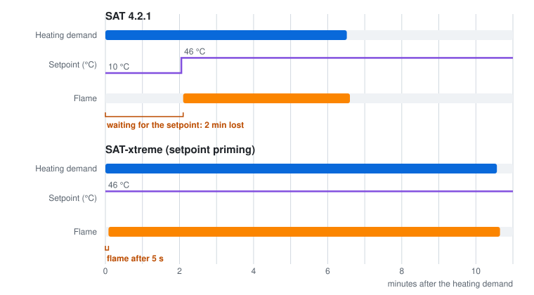

# SAT-xtreme

*An unofficial fork of [Smart Autotune Thermostat (SAT)](https://github.com/Alexwijn/SAT). All credit for SAT goes
to its authors.*

SAT-xtreme is SAT for Home Assistant with bug fixes and extra, opt-in features for boilers behind an OpenTherm
gateway. It helps most when a thermostat on the bus passes the setpoint on slowly (such as a Nest), or when the
boiler ignores the modulation limit (such as an Intergas). Every feature is off by default; with everything off,
it behaves like SAT 4.2.1 plus the fixes.

*One measured PWM block on the tested setup (Intergas Xtreme 30, OpenTherm Gateway, Nest on the bus),
21 October 2026.*

**The result:** the boiler fires **3 to 5 seconds** after the heating demand instead of **64 to 150 seconds**,
and every block burns for as long as it was planned, instead of 1 to 2.5 minutes shorter.

## Is this for you?

SAT-xtreme helps when:

- **your thermostat stays on the bus as a fallback** and passes SAT's setpoint on slowly, so the boiler starts
  late in every heating block;
- **your boiler ignores the modulation limit** that SAT sends, so SAT's calibration and power readings are off;
- **your boiler cycles a lot**: short burns, burns that start during the boiler's anti-cycling time, or short
  hot water burns that restart it.

It also lets you tune how strongly SAT corrects the heating curve, learn the overshoot protection value during
normal heating, and turn the boiler's hot water keep-warm off at night.

If your gateway sends the setpoint directly and your boiler follows the modulation limit, the official SAT may be
all you need.

## Supported gateways

The same as the official SAT: the [OpenTherm Gateway](https://otgw.tclcode.com/) (MQTT or serial), the DIYLess
Master OpenTherm Shield, Ihor Melnyk's OpenTherm adapter, Jiří Praus' OpenTherm Gateway Arduino Shield,
ESPHome OpenTherm, EMS-ESP, and a plain switch or relay. The fork features have only been tested with an
**OpenTherm Gateway over MQTT** with an Intergas Xtreme 30 and a Nest on the bus; reports from other setups are
welcome on the [issue tracker](https://github.com/justink0k/SAT-xtreme/issues).

## Compared with SAT 4.2.1

| | SAT 4.2.1 | SAT-xtreme |
|---|---|---|
| Setpoint between PWM blocks | Drops to 10 °C, so the next block waits for the thermostat on the bus to pass the setpoint on. | **Setpoint priming:** stays ready, only the heating demand switches; the boiler fires within seconds. |
| Boilers that ignore `MM=` | Keeps sending the limit. | **Ignore modulation limit:** stops sending it and keeps using the reported modulation and power. |
| PWM timing | Counts time since the heating demand; pauses can be shorter than the boiler's anti-cycling time. | **Boiler timing:** counts real burn time, waits for the anti-cycling time, longer minimum burn. |
| Overshoot protection value | A fixed value. | **Learned OPV:** learned during normal heating, used only when you choose so. |
| Calibration | About 20 minutes, relies on `MM=0`, could exceed the maximum setpoint. | **Slow calibration:** tests the modulation limit, median of several rounds, never above the maximum setpoint. |
| PID strength | Only through the heating curve coefficient. | **PID settings:** gain factor, maximum rise above the curve, manual gains. |
| Hot water keep-warm | Left to the boiler. | **Keep-warm switch:** turn it off and on, for example at night. |

The full comparison, a dashboard created with one click, boiler presets and more are in the
[manual](https://justink0k.github.io/SAT-xtreme/background/#sat-xtreme-compared-to-sat-421).

## Install

1. In HACS, add `https://github.com/justink0k/SAT-xtreme` as a custom repository of type *Integration* (or
   use the button above) and install **SAT-xtreme**.
2. Restart Home Assistant and refresh the browser cache.
3. Add the integration **SAT-xtreme** under *Settings → Devices & services*, and create the dashboard from
   *Settings → System → Repairs*.
4. Turn on the features you want, one at a time, under *Configure → Xtreme profile (fork)* and
   *Configure → PID settings (fork)*.

SAT-xtreme has its own domain, `sat_xtreme`, so it can be installed next to the official SAT. Do not let both
control the same boiler.

### Moving from the official SAT

Choose **Move a configuration from SAT** when you add the integration. All settings, the entity IDs and their
history are kept. Then remove the official SAT in HACS, and change automations that call `sat.` actions to
`sat_xtreme.` ([details](https://justink0k.github.io/SAT-xtreme/installation/#moving-from-the-official-sat)).

#### Check after moving from SAT

A few bug fixes change behaviour you may have got used to:

- **Synchronize with thermostat attached to the boiler** (Presets page) now works. If you turned it on once, SAT
  now sends its target temperature to the thermostat on the bus.
- **Duty cycles per hour** are counted over the last 60 minutes instead of per clock hour, which can mean
  slightly fewer starts.
- **Dynamic minimum setpoint:** the learned value is now loaded after a restart, if you use this option.
- **Automatic gains chosen in the setup wizard** now take effect, but only for new installations: a moved
  configuration keeps the gains it used.

## More

- [Manual](https://justink0k.github.io/SAT-xtreme/): how SAT works, gateways, every setting
- [Fork features](https://justink0k.github.io/SAT-xtreme/prime-setpoint/) and
  [first steps](https://justink0k.github.io/SAT-xtreme/first-steps/)
- [Entities](https://justink0k.github.io/SAT-xtreme/entities/) and
  [actions](https://justink0k.github.io/SAT-xtreme/actions/)
- [Bug fixes](https://justink0k.github.io/SAT-xtreme/troubleshooting/#bug-fixes-in-the-fork)
- [CHANGES_XTREME.md](CHANGES_XTREME.md): every change, with its version and files

## Acknowledgement and disclaimer

SAT-xtreme builds on the [Smart Autotune Thermostat](https://github.com/Alexwijn/SAT) by Alexwijn and its
contributors. Thank you! Please report problems with this fork on
[its own issue tracker](https://github.com/justink0k/SAT-xtreme/issues), not to the official SAT.

This software controls a central heating boiler. Use it at your own risk, without any warranty. The license is
GPL-3.0, the same as the official SAT; see [LICENSE](LICENSE).
