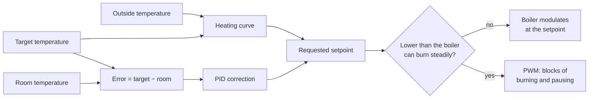

# The control loop

A classic thermostat switches the boiler on until the room is warm and then off again. SAT works the way a
modern weather-compensated controller does: it keeps the boiler running as long and as low as possible, and
decides **the temperature of the water** (the *flow temperature* or *control setpoint*) that the boiler
should make.



## Heating curve

The heating curve gives the water temperature that keeps the house at the target temperature for the current
outside temperature: the colder it is outside, the warmer the water. SAT uses this formula:

```text
heating curve = base + coefficient / 4 × (4 × (target − 20) + 0.03 × (outside − 20)² − 0.4 × (outside − 20))
```

The base is 27.2 °C for radiators and heat pumps and 20 °C for underfloor heating. For example, with a target
of 20 °C, 0 °C outside and a coefficient of 2.0, the heating curve is 27.2 + 0.5 × 20 = 37.2 °C.

The **coefficient** is the most important setting of SAT: it matches the curve to how much heat your house
loses. When it is right, the room stays close to the target with only a small PID correction. See
[Heating curve coefficient](settings-general.md#heating-curve-coefficient) for how to tune it. The current
value is in the sensor *Heating Curve*.

## PID correction

The heating curve is a prediction; the PID controller corrects it with what really happens in the room. The
*error* is the target minus the room temperature (sensor *Error Value*).

- **P (proportional)**: more correction the further the room is from the target.
- **I (integral)**: slowly removes a small difference that remains. SAT only uses it when the room is within
  0.1 °C of the target.
- **D (derivative)**: reacts to how fast the room temperature changes; it brakes when the room warms up fast.

The requested setpoint is the heating curve plus the PID correction, at least 10 °C and never above the
[maximum setpoint](settings-general.md#maximum-setpoint). The fork can limit how far the correction may go
above the curve ([maximum rise](settings-pid.md#maximum-rise-above-the-heating-curve)), and shows the
correction in the sensor *Xtreme fork: PID Output*.

### Gains

The strength of P, I and D are the *gains* kP, kI and kD. With **automatic gains** (the default), SAT
calculates them from the heating curve, so they follow the weather: mild when it is mild outside, stronger
when it is cold. With the *Adaptive Controller* (version 3, the default) no further tuning is needed; the
older controller versions use the *Automatic Gains Value* and *Derivative Time Weight*. You can also enter
the gains yourself. In the fork, the [PID settings](settings-pid.md) page adds a gain factor to make the
automatic correction calmer or stronger.

## When the boiler cannot go low enough

A boiler has a minimum power. In mild weather the house needs less heat than that, and the boiler would
overshoot the setpoint, switch itself off, wait, and start again: short cycles that cost gas and wear. SAT
handles this with **overshoot protection** and **pulse width modulation (PWM)**: it heats in blocks of a few
minutes at a temperature the boiler can hold, with pauses in between. This is explained in
[Overshoot protection and PWM](overshoot-protection.md).

## Several rooms

With [rooms](setup-wizard.md#4-areas) configured, SAT also looks at the climates of other rooms. In
*Comfort* mode it uses the largest error of all rooms, so the coldest room decides; in *Eco* mode only the
main room counts. See [Heating mode](settings-general.md#heating-mode).

## Presets and windows

The climate entity has presets (Home, Away, Sleep, Comfort, Activity) with their own target temperatures;
see [Presets](settings-presets.md). With window or door [contact sensors](settings-general.md#contact-sensors),
SAT switches to the *Activity* preset (10 °C by default) when a window is open longer than the
[minimum open time](settings-system.md#minimum-time-for-window-to-be-open), and restores the previous target
temperature when it closes.

## The boiler and the gateway

SAT talks to the boiler through a [gateway](gateways.md). With OpenTherm it sends the control setpoint,
whether heating is on, and optionally the maximum modulation. With a plain switch it can only turn the
heating on and off, so it always uses PWM.
